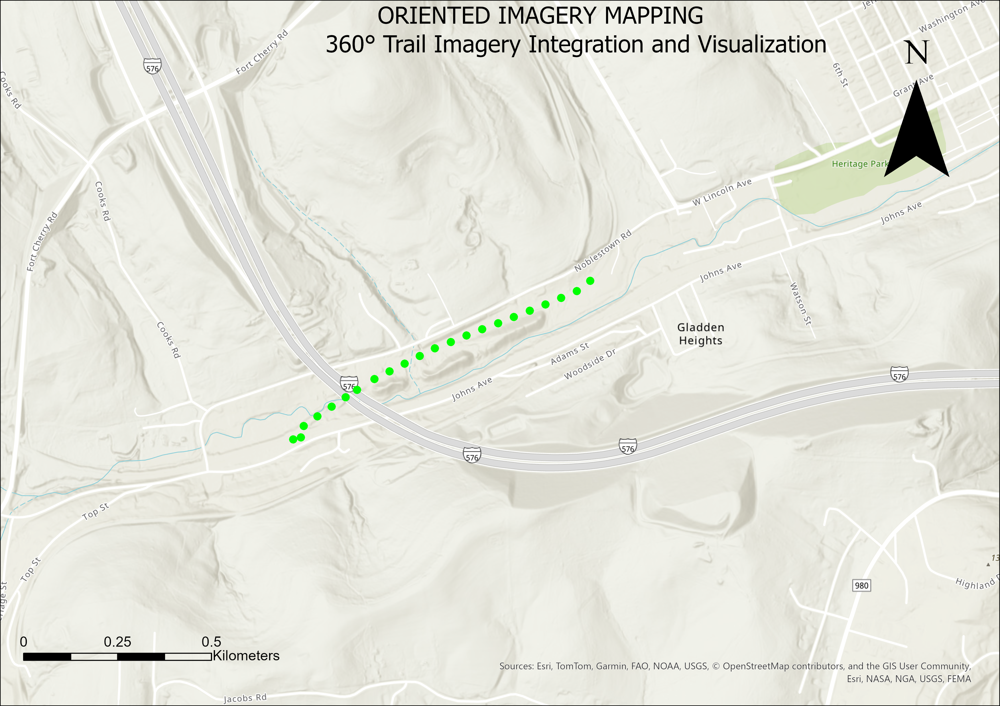

# Creating and Visualizing an Oriented Imagery Dataset Using ArcGIS Pro

## Project Overview
This project demonstrates the practical application of Oriented Imagery capabilities in ArcGIS Pro. It focuses on creating an oriented imagery dataset, integrating georeferenced 360-degree images and visualizing their spatial locations in a GIS environment.

## Project Objectives
- Create an oriented imagery dataset.
- Integrate georeferenced 360-degree images.
- Visualize image locations on a geographic map.
- Explore oriented imagery using ArcGIS Pro tools.
- Understand the application of oriented imagery in GIS workflows.

## Software Used
- ArcGIS Pro

## Methodology
1. Created an oriented imagery dataset named Trail360.
2. Configured the dataset properties.
3. Added images to the oriented imagery dataset.
4. Visualized image locations as point features.
5. Explored the spatial distribution of imagery using a topographic basemap and hillshade.

## Skills Demonstrated
- Geographic Information Systems (GIS)
- ArcGIS Pro
- Oriented Imagery
- 360-Degree Image Visualization
- Geospatial Data Management
- Spatial Data Visualization

## Learning Outcomes
Developed practical understanding of oriented imagery datasets and their integration into GIS workflows for visualizing geographic locations and image-based information.

## Project Reference
Educational practical exercise completed using Esri MOOC training material.

**Project Type:** Educational GIS Project
## Final Project Map

